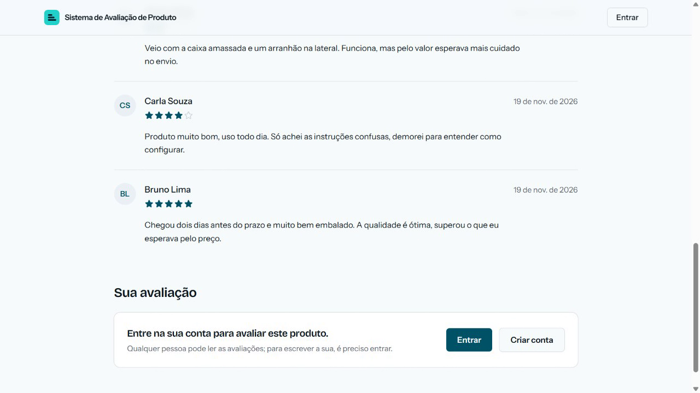

# Product Review System

**English** · [Português](README.pt-BR.md)

[](https://github.com/Alexandre-Boer/sistema-avaliacao-de-produto/actions/workflows/ci.yml) [](LICENSE)

A web application where anyone can browse products and read reviews, signed-in users rate products with a score and a comment, and an AI agent summarizes what customers said about each product.

> Project for the **introductory module of the Postgraduate Program in AI Engineering at [Coders University](https://www.codersuniversity.com.br/)**, a program endorsed by ESIC Internacional. Beyond the product itself, the goal of the module was to practice spec-driven development with AI agents: every feature started as a spec, became a reviewed plan, and only then was implemented.


The application interface, the specs, the plans and the commit history are in Brazilian Portuguese, the language of the course.

## Table of contents

- [Features](#features)
- [Tech stack](#tech-stack)
- [Getting started](#getting-started)
- [AI summary](#ai-summary)
- [Importing products with n8n](#importing-products-with-n8n)
- [API](#api)
- [Tests and code quality](#tests-and-code-quality)
- [Project structure](#project-structure)
- [Design decisions](#design-decisions)
- [Development process](#development-process)
- [Known limitations](#known-limitations)
- [License](#license)
- [Author](#author)

## Features

- **Sign-up and sign-in** with e-mail and password. Passwords are stored with bcrypt and the session lives in a signed HttpOnly cookie.
- **Public product list** with infinite scrolling.
- **Product page** with image, description, link to the store, average score, score distribution and the most recent reviews.
- **Reviews** from 1 to 5 stars with a comment, one per person per product, for signed-in users only.
- **AI summary**: a [Mastra](https://mastra.ai) agent reads the reviews and writes an overall summary, highlighted between the product information and the reviews.
- **Automated product import**: an [n8n](https://n8n.io) workflow reads a public deals page and registers the products through the API.



## Tech stack

| Layer | Tools |
| --- | --- |
| Interface | Next.js 16 (App Router, Cache Components), React 19, Tailwind CSS 4, shadcn/ui, Phosphor Icons |
| Forms and data | React Hook Form, Zod 4, TanStack Query |
| Server | Next.js Route Handlers, `jose` (JWT), `bcryptjs` |
| Database | Supabase (PostgreSQL), accessed only by the server |
| AI | Mastra (`@mastra/core`) with OpenAI `gpt-4o-mini` or a local model through Ollama |
| Automation | n8n on Docker |
| Quality | Strict TypeScript, Vitest, Testing Library, Biome |

## Getting started

### Prerequisites

- Node.js 22.13 or later
- A [Supabase](https://supabase.com) account (the free plan is enough)
- Docker, only for the local AI summary and for n8n

### 1. Install the dependencies

```bash
git clone https://github.com/Alexandre-Boer/sistema-avaliacao-de-produto.git
cd sistema-avaliacao-de-produto
npm install
```

### 2. Create the database

Create a Supabase project and run the files in `supabase/migrations/`, in order, in the dashboard's **SQL Editor**. With the [Supabase CLI](https://supabase.com/docs/guides/cli), the equivalent is:

```bash
supabase link --project-ref <project-ref>
supabase db push
```

The migrations create the `accounts`, `products`, `products_feedbacks`, `sign_in_attempts` and `products_ai_summaries` tables, all with RLS enabled.

### 3. Configure the environment

```bash
cp .env.example .env.local
```

| Variable | Required | Description |
| --- | --- | --- |
| `NEXT_PUBLIC_SUPABASE_URL` | yes | URL of the Supabase project |
| `SUPABASE_SERVICE_ROLE_KEY` | yes | The `service_role` key. Server-side only |
| `SESSION_SECRET` | yes | Long random secret that signs the session cookie |
| `AI_SUMMARY_MODEL` | no | Summary model, in `provider/model` format. Default: `openai/gpt-4o-mini` |
| `AI_SUMMARY_BASE_URL` | no | Address of an OpenAI-compatible API (for example, a local Ollama) |
| `AI_SUMMARY_API_KEY` | no | Key for the address above, when it requires one |
| `OPENAI_API_KEY` | no | OpenAI key, for `openai/...` models |

### 4. Run the application

```bash
npm run dev
```

Open [http://localhost:3000](http://localhost:3000). For a production build: `npm run build` and `npm run start`.

The database starts empty. Register products through the [API](#api) or with the [n8n workflow](#importing-products-with-n8n).

## AI summary

The block appears on products with 3 or more reviews. The agent lives in `src/mastra/agents/feedback-summary-agent.ts` and the model is chosen by environment variable, so switching providers does not change any code.

**Free local model (Ollama):**

```bash
docker compose -f infra/ollama/docker-compose.yml up -d
docker exec sap-ollama ollama pull gemma3:4b
```

```bash
# .env.local
AI_SUMMARY_MODEL=custom/gemma3:4b
AI_SUMMARY_BASE_URL=http://localhost:11434/v1
```

The `docker-compose.yml` reserves an NVIDIA GPU. Without a GPU, remove the `deploy` block and the model runs on the CPU, more slowly.

**OpenAI:** remove the two variables above and set `OPENAI_API_KEY`. The default is `openai/gpt-4o-mini`.

How it works:

1. The product page requests the summary inside its own `<Suspense>`, so the header and the reviews never wait for the AI.
2. The summary is stored in the `products_ai_summaries` table, together with the number of reviews it covered.
3. The model is only called again when that number changes, that is, when a new review arrives.
4. If the AI is not configured, fails, or takes longer than 30 seconds, the block does not appear and the rest of the page works as usual.

## Importing products with n8n

```bash
docker compose -f infra/n8n/docker-compose.yml up -d
docker exec sap-n8n n8n import:workflow --input=/workflows/amazon-deals.json
```

Open [http://localhost:5678](http://localhost:5678), create the local user and run the **Ofertas da Amazon → Produtos** workflow. The application must be running on port 3000.

The workflow downloads the HTML of a public deals page, extracts the name, price, rating, link and image of each product, drops the ones already registered (by link) and sends the new ones to `POST /api/v1/products`.

This is an automation exercise from the course. Before using something similar outside a study environment, check the terms of use of the source site.

## API

| Method | Route | Authentication | Description |
| --- | --- | --- | --- |
| `POST` | `/api/v1/sign-up` | no | Creates an account |
| `POST` | `/api/v1/sign-in` | no | Authenticates and sets the session cookie |
| `POST` | `/api/v1/sign-out` | no | Ends the session |
| `GET` | `/api/v1/products?limit=12&offset=0` | no | Lists products, paginated |
| `POST` | `/api/v1/products` | no (see [known limitations](#known-limitations)) | Registers a product |
| `POST` | `/api/v1/products/:id/feedbacks` | yes | Reviews a product |

Example of registering a product:

```bash
curl -X POST http://localhost:3000/api/v1/products \
  -H "Content-Type: application/json" \
  -d '{
    "name": "Wireless headphones",
    "description": "Noise cancelling and 30 hours of battery life.",
    "externalLink": "https://example.com/headphones",
    "imageUrl": "https://example.com/headphones.jpg"
  }'
```

## Tests and code quality

```bash
npm test          # Vitest: 291 tests in 37 files
npm run lint      # Biome: lint and formatting
npm run build     # production build, with type checking
```

Every push runs lint, tests and build on GitHub Actions (`.github/workflows/ci.yml`).

The tests cover the validation schemas, the services (with Supabase replaced by test doubles), the endpoints and the components. No test calls an AI model: the agent is replaced by a test double.

## Project structure

```
src/
  app/
    (site)/            pages with the site header: product list and product page
    auth/              sign-in and sign-up pages
    api/v1/            endpoints
  components/          components by domain (products, feedback, layout, ui)
  lib/                 session, password, validation (Zod), Supabase client
  mastra/              AI agent and model selection
  server/              business rules by domain (accounts, products, feedbacks, ai-summary)
supabase/migrations/   database schema
infra/
  n8n/                 docker-compose and import workflow
  ollama/              docker-compose for the local model
docs/
  ARCHITECTURE.md      architecture overview
  specs/               specification of each feature
  plans/               implementation plan of each feature
  assets/              demo video and screenshots
```

## Design decisions

- **Database accessed only by the server.** The tables have RLS enabled and no policies, so the public Supabase key cannot read anything. All access goes through the server with the `service_role` key, and the rules live in one place (`src/server`).
- **Custom session instead of Supabase Auth.** The module asked for sign-up and sign-in to be implemented. The session is an HS256 JWT in an HttpOnly cookie valid for 7 days, and passwords use bcrypt.
- **Shared validation.** The same Zod schema validates the form in the browser and the request body on the server.
- **Rules enforced by the database.** "One review per person per product" is a unique index, not just a check in code, so it also holds when two submissions arrive at the same time.
- **Endpoint protections.** Origin check on `POST` requests, a per-e-mail limit on sign-in attempts, and responses that do not reveal which e-mails have an account.
- **Product page with a real `404`.** The product lookup happens before the first byte of the response; only the reviews, the AI summary and the session-dependent block are streamed.
- **AI summary stored in the database.** It avoids a paid model call on every visit and keeps the page fast.
- **Comments treated as untrusted content.** They go into the model request inside a delimiter, without `<` and `>`, and the agent's instructions tell it to ignore orders written in them. The "IGNORE TODAS AS INSTRUÇÕES..." ("ignore all instructions") review that appears in the demo is that test. Only the score and the comment are sent, never the reviewer's name or e-mail.
- **Configurable model.** The code does not depend on a provider: the same agent runs with `gpt-4o-mini` or with a free local model.

The decisions for each feature, including what was discarded and why, are recorded in the "Resultado" section of the specs and in the plans under `docs/plans/` (in Portuguese).

## Development process

The project was built with a coding agent (Claude Code), in a three-step flow per feature:

1. **Spec** (`docs/specs/`): context, requirements, what to do and what not to do, acceptance criteria.
2. **Plan** (`docs/plans/`): small tasks, with the tests written before the code, points of attention for review, and the decisions that depart from the spec. Nothing is implemented before the plan is approved.
3. **Execution and review**: independent features were implemented in parallel by subagents, each on its own branch, and integrated with a merge. After each integration there was a code review and a round of fixes, recorded in the spec itself.

The history follows [Conventional Commits](https://www.conventionalcommits.org/) in Portuguese (`feat:`, `fix:`, `docs:`, `test:`, `merge:`).

## Known limitations

- **`POST /api/v1/products` does not require authentication.** This was a decision within the scope of the course, so the n8n workflow can register products without credentials. In production this endpoint would need authentication or an API key.
- **Summary quality with a local model.** A small model sometimes generalizes beyond what the comments say. The block always states that the text was generated by AI and may contain inaccuracies.
- **The summary is generated on visit.** Whoever opens the page right after a new review waits a few seconds for the block.
- **Sign-in attempt limit is per e-mail.** There is no per-IP limit, so someone can temporarily block another person's sign-in.
- **No password recovery and no e-mail confirmation.**
- **The product page's `404` relies on a still-unstable Next.js API** (`unstable_paramMatching`), which may change in an update.

## License

Distributed under the [MIT](LICENSE) license.

## Author

**Alexandre Boer** · [GitHub](https://github.com/Alexandre-Boer)

Project developed for study purposes in the introductory module of the Postgraduate Program in AI Engineering at Coders University (endorsed by ESIC Internacional).
