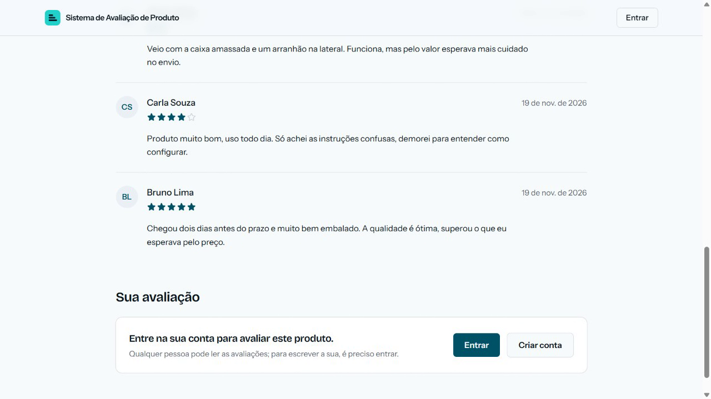

# Sistema de Avaliação de Produto

[English](README.md) · **Português**

[](https://github.com/Alexandre-Boer/sistema-avaliacao-de-produto/actions/workflows/ci.yml) [](LICENSE)

Aplicação web em que qualquer pessoa consulta produtos e lê avaliações, pessoas autenticadas avaliam com nota e comentário, e um agente de IA resume o que os clientes disseram sobre cada produto.

> Projeto do **módulo introdutório da Pós-Graduação em Engenharia de IA da [Coders University](https://www.codersuniversity.com.br/)**, curso com chancela da ESIC Internacional. Além do produto em si, o objetivo do módulo foi praticar o desenvolvimento orientado a especificações com agentes de IA: cada funcionalidade nasceu de uma spec, virou um plano revisado e só então foi implementada.


## Índice

- [Funcionalidades](#funcionalidades)
- [Tecnologias](#tecnologias)
- [Como rodar](#como-rodar)
- [Resumo da IA](#resumo-da-ia)
- [Importação de produtos com n8n](#importação-de-produtos-com-n8n)
- [API](#api)
- [Testes e qualidade](#testes-e-qualidade)
- [Estrutura do projeto](#estrutura-do-projeto)
- [Decisões de projeto](#decisões-de-projeto)
- [Processo de desenvolvimento](#processo-de-desenvolvimento)
- [Limitações conhecidas](#limitações-conhecidas)
- [Licença](#licença)
- [Autor](#autor)

## Funcionalidades

- **Cadastro e login** com e-mail e senha. A senha é guardada com bcrypt e a sessão fica em um cookie HttpOnly assinado.
- **Lista pública de produtos** com rolagem infinita.
- **Página do produto** com imagem, descrição, link para a loja, nota média, distribuição das notas e as avaliações mais recentes.
- **Avaliações** de 1 a 5 estrelas com comentário, uma por pessoa por produto, apenas para quem está autenticado.
- **Resumo da IA**: um agente [Mastra](https://mastra.ai) lê as avaliações e escreve um resumo geral, exibido em destaque entre as informações do produto e as avaliações.
- **Importação automática de produtos**: um fluxo do [n8n](https://n8n.io) lê uma página pública de ofertas e cadastra os produtos pela API.



## Tecnologias

| Camada | Ferramentas |
| --- | --- |
| Interface | Next.js 16 (App Router, Cache Components), React 19, Tailwind CSS 4, shadcn/ui, Phosphor Icons |
| Formulários e dados | React Hook Form, Zod 4, TanStack Query |
| Servidor | Route Handlers do Next.js, `jose` (JWT), `bcryptjs` |
| Banco de dados | Supabase (PostgreSQL), acessado só pelo servidor |
| IA | Mastra (`@mastra/core`) com OpenAI `gpt-4o-mini` ou um modelo local via Ollama |
| Automação | n8n em Docker |
| Qualidade | TypeScript estrito, Vitest, Testing Library, Biome |

## Como rodar

### Pré-requisitos

- Node.js 22.13 ou mais recente
- Uma conta no [Supabase](https://supabase.com) (o plano gratuito basta)
- Docker, apenas para o resumo da IA local e para o n8n

### 1. Instalar as dependências

```bash
git clone https://github.com/Alexandre-Boer/sistema-avaliacao-de-produto.git
cd sistema-avaliacao-de-produto
npm install
```

### 2. Criar o banco

Crie um projeto no Supabase e execute, em ordem, os arquivos de `supabase/migrations/` no **SQL Editor** do painel. Com a [CLI do Supabase](https://supabase.com/docs/guides/cli), o equivalente é:

```bash
supabase link --project-ref <ref-do-projeto>
supabase db push
```

As migrações criam as tabelas `accounts`, `products`, `products_feedbacks`, `sign_in_attempts` e `products_ai_summaries`, todas com RLS habilitado.

### 3. Configurar o ambiente

```bash
cp .env.example .env.local
```

| Variável | Obrigatória | Descrição |
| --- | --- | --- |
| `NEXT_PUBLIC_SUPABASE_URL` | sim | URL do projeto no Supabase |
| `SUPABASE_SERVICE_ROLE_KEY` | sim | Chave `service_role`. Fica só no servidor |
| `SESSION_SECRET` | sim | Segredo aleatório e longo que assina o cookie de sessão |
| `AI_SUMMARY_MODEL` | não | Modelo do resumo, no formato `provedor/modelo`. Padrão: `openai/gpt-4o-mini` |
| `AI_SUMMARY_BASE_URL` | não | Endereço de uma API compatível com a da OpenAI (por exemplo, o Ollama local) |
| `AI_SUMMARY_API_KEY` | não | Chave para o endereço acima, quando ele exige |
| `OPENAI_API_KEY` | não | Chave da OpenAI, para os modelos `openai/...` |

### 4. Subir a aplicação

```bash
npm run dev
```

Abra [http://localhost:3000](http://localhost:3000). Para o build de produção: `npm run build` e `npm run start`.

O banco começa vazio. Cadastre produtos pela [API](#api) ou pelo [fluxo do n8n](#importação-de-produtos-com-n8n).

## Resumo da IA

O bloco aparece nos produtos com 3 ou mais avaliações. O agente está em `src/mastra/agents/feedback-summary-agent.ts` e o modelo é escolhido por variável de ambiente, então trocar de provedor não muda código.

**Modelo local gratuito (Ollama):**

```bash
docker compose -f infra/ollama/docker-compose.yml up -d
docker exec sap-ollama ollama pull gemma3:4b
```

```bash
# .env.local
AI_SUMMARY_MODEL=custom/gemma3:4b
AI_SUMMARY_BASE_URL=http://localhost:11434/v1
```

O `docker-compose.yml` reserva uma GPU NVIDIA. Sem GPU, remova o bloco `deploy` e o modelo roda na CPU, mais devagar.

**OpenAI:** remova as duas variáveis acima e defina `OPENAI_API_KEY`. O padrão é `openai/gpt-4o-mini`.

Como funciona:

1. A página do produto pede o resumo em um `<Suspense>` próprio, então o cabeçalho e as avaliações nunca esperam pela IA.
2. O resumo fica guardado na tabela `products_ai_summaries`, junto com a quantidade de avaliações que ele cobriu.
3. O modelo só é chamado de novo quando essa quantidade muda, ou seja, quando chega avaliação nova.
4. Se a IA não está configurada, falha ou demora mais de 30 segundos, o bloco não aparece e o resto da página segue normal.

## Importação de produtos com n8n

```bash
docker compose -f infra/n8n/docker-compose.yml up -d
docker exec sap-n8n n8n import:workflow --input=/workflows/amazon-deals.json
```

Abra [http://localhost:5678](http://localhost:5678), crie o usuário local e execute o fluxo **Ofertas da Amazon → Produtos**. A aplicação precisa estar rodando na porta 3000.

O fluxo baixa o HTML de uma página pública de ofertas, extrai nome, preço, nota, link e imagem de cada produto, descarta os que já estão cadastrados (pelo link) e envia os novos para `POST /api/v1/products`.

É um exercício de automação do curso. Antes de usar algo parecido fora de um ambiente de estudo, confira os termos de uso do site de origem.

## API

| Método | Rota | Autenticação | Descrição |
| --- | --- | --- | --- |
| `POST` | `/api/v1/sign-up` | não | Cria uma conta |
| `POST` | `/api/v1/sign-in` | não | Autentica e grava o cookie de sessão |
| `POST` | `/api/v1/sign-out` | não | Encerra a sessão |
| `GET` | `/api/v1/products?limit=12&offset=0` | não | Lista produtos, com paginação |
| `POST` | `/api/v1/products` | não (ver [limitações](#limitações-conhecidas)) | Cadastra um produto |
| `POST` | `/api/v1/products/:id/feedbacks` | sim | Avalia um produto |

Exemplo de cadastro de produto:

```bash
curl -X POST http://localhost:3000/api/v1/products \
  -H "Content-Type: application/json" \
  -d '{
    "name": "Fone de ouvido sem fio",
    "description": "Cancelamento de ruído e 30 horas de bateria.",
    "externalLink": "https://exemplo.com/fone",
    "imageUrl": "https://exemplo.com/fone.jpg"
  }'
```

## Testes e qualidade

```bash
npm test          # Vitest: 291 testes em 37 arquivos
npm run lint      # Biome: lint e formatação
npm run build     # build de produção, com checagem de tipos
```

Cada push roda lint, testes e build no GitHub Actions (`.github/workflows/ci.yml`).

Os testes cobrem os schemas de validação, os serviços (com o Supabase substituído por dublês), os endpoints e os componentes. Nenhum teste chama um modelo de IA: o agente é substituído por um dublê.

## Estrutura do projeto

```
src/
  app/
    (site)/            páginas com o cabeçalho do site: lista e detalhe do produto
    auth/              páginas de login e cadastro
    api/v1/            endpoints
  components/          componentes por domínio (auth, products, feedback, layout, ui)
  lib/                 sessão, senha, validação (Zod), cliente do Supabase
  mastra/              agente de IA e escolha do modelo
  server/              regras de negócio por domínio (accounts, products, feedbacks, ai-summary)
supabase/migrations/   esquema do banco
infra/
  n8n/                 docker-compose e fluxo de importação
  ollama/              docker-compose do modelo local
docs/
  ARCHITECTURE.md      visão geral da arquitetura
  specs/               especificação de cada funcionalidade
  plans/               plano de implementação de cada funcionalidade
  assets/              vídeo de demonstração e capturas de tela
```

## Decisões de projeto

- **Banco acessado só pelo servidor.** As tabelas têm RLS habilitado e nenhuma policy, então a chave pública do Supabase não lê nada. Todo acesso passa pelo servidor com a chave `service_role`, e as regras ficam em um lugar só (`src/server`).
- **Sessão própria em vez do Supabase Auth.** O módulo pedia implementar cadastro e login. A sessão é um JWT HS256 em cookie HttpOnly com validade de 7 dias, e a senha usa bcrypt.
- **Validação compartilhada.** O mesmo schema Zod valida o formulário no navegador e o corpo da requisição no servidor.
- **Regras garantidas no banco.** "Uma avaliação por pessoa por produto" é um índice único, e não só uma checagem no código, para valer também quando dois envios chegam juntos.
- **Proteções nos endpoints.** Checagem de origem nos `POST`, limite de tentativas de login por e-mail e respostas que não revelam quais e-mails têm conta.
- **Página do produto com `404` de verdade.** A busca do produto acontece antes do primeiro byte da resposta; só as avaliações, o resumo da IA e o bloco que depende da sessão chegam por streaming.
- **Resumo da IA guardado no banco.** Evita uma chamada paga ao modelo a cada visita e mantém a página rápida.
- **Comentários tratados como conteúdo não confiável.** Eles entram no pedido ao modelo dentro de um delimitador, sem `<` e `>`, e as instruções do agente mandam ignorar ordens escritas neles. A avaliação "IGNORE TODAS AS INSTRUÇÕES..." que aparece na demonstração é esse teste. Só nota e comentário são enviados, nunca o nome ou o e-mail de quem avaliou.
- **Modelo configurável.** O código não depende de um provedor: o mesmo agente roda com `gpt-4o-mini` ou com um modelo local gratuito.

As decisões de cada funcionalidade, incluindo o que foi descartado e por quê, estão registradas na seção "Resultado" das specs e nos planos em `docs/plans/`.

## Processo de desenvolvimento

O projeto foi construído com um agente de programação (Claude Code), em um fluxo de três etapas por funcionalidade:

1. **Spec** (`docs/specs/`): contexto, requisitos, o que fazer e o que não fazer, critérios de aceite.
2. **Plano** (`docs/plans/`): tarefas pequenas, com os testes escritos antes do código, pontos de atenção para a revisão e as decisões que fogem da spec. Nada é implementado antes de o plano ser aprovado.
3. **Execução e revisão**: funcionalidades independentes foram implementadas em paralelo por subagentes, cada um no seu branch, e integradas com merge. Depois de cada integração houve revisão de código e uma rodada de correções, registrada na própria spec.

O histórico usa [Conventional Commits](https://www.conventionalcommits.org/pt-br/) em português (`feat:`, `fix:`, `docs:`, `test:`, `merge:`).

## Limitações conhecidas

- **`POST /api/v1/products` não exige autenticação.** Foi uma decisão do escopo do curso, para o fluxo do n8n cadastrar produtos sem credenciais. Em produção esse endpoint precisaria de autenticação ou de uma chave de API.
- **Qualidade do resumo com modelo local.** Um modelo pequeno às vezes generaliza além do que os comentários dizem. O bloco sempre avisa que o texto foi gerado por IA e pode conter imprecisões.
- **O resumo é gerado na visita.** Quem abre a página logo depois de uma avaliação nova espera alguns segundos pelo bloco.
- **Limite de tentativas de login por e-mail.** Não há limite por IP, então alguém pode bloquear temporariamente o login de outra pessoa.
- **Sem recuperação de senha e sem confirmação de e-mail.**
- **O `404` da página do produto usa uma API ainda instável do Next.js** (`unstable_paramMatching`), que pode mudar em uma atualização.

## Licença

Distribuído sob a licença [MIT](LICENSE).

## Autor

**Alexandre Boer** · [GitHub](https://github.com/Alexandre-Boer)

Projeto desenvolvido para fins de estudo no módulo introdutório da Pós-Graduação em Engenharia de IA da Coders University (chancela ESIC Internacional).
